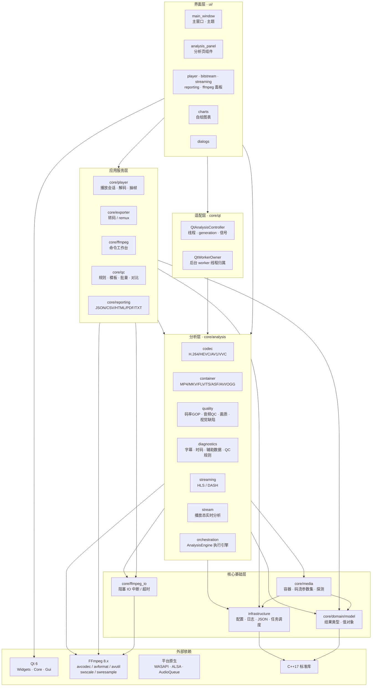

# VideoEye 2.0 - 现代化视频流分析软件

[](LICENSE)
[](https://isocpp.org/)
[](https://www.qt.io/)
[](https://ffmpeg.org/)
[]()
[]()

## 项目简介

VideoEye 是一款开源的视频流分析软件，支持 HTTP、RTMP、RTSP 网络流及本地文件输入，提供实时码流分析、帧级信息、容器结构解析与图形化展示。采用 C++17 + Qt6 技术栈，深色专业风格 UI。

**平台口径（别照着"跨平台"三个字做选型）**：Windows 与 Linux 有官方二进制、且每次发布都在干净机器上做过安装 + 启动验证；macOS **没有官方二进制**，代码层面支持、但不在 CI 矩阵里，也没有做过干净机器安装验证 —— 在 macOS 上请从源码构建（见下方「平台支持矩阵」）。

## 主要特性

- **多源输入**: HTTP / RTMP / RTSP 网络流及本地文件
- **流分析**: 实时统计 FPS、码率、关键帧并可视化曲线
- **视频帧分析**: 单独标签页展示 I/P/B 帧类型、序号、PTS、时间戳
- **容器结构分析**: 统一调度解析 MP4/MOV、MKV/WebM、AVI、FLV、MPEG-TS、ASF/WMV、OGG；MP4 树到字段级（`ftyp`/`mvhd`/`tkhd`/`stsd` 入口 + `avcC`/`hvcC`/`av1C`/`esds`/`colr`/`pasp`/`btrt`/`sidx`/`moof`），MPEG-TS 支持 188/192/204 包长自适应、失步重同步、PAT/PMT 跨包组装、描述符与 SDT 服务名、PCR 与连续计数统计；MKV/WebM 除元素树外另跑一遍**只读元素头的顺序扫描**（内存 O(1)、覆盖到片尾），给出 Cues 索引 / Cluster 时间轴 / CodecPrivate / unknown-size 等体检结论。EBML 元素树只读开头 32 MiB 建树（`scan_truncated` 显式声明尾部未覆盖，不再整份读入内存），树内块节点封顶 2 万但 `total_simpleblocks`/`total_blockgroups` 仍按全量计数
- **媒体信息**: 基于 FFmpeg `libavformat` 展示完整元数据（容器 / 视频 / 音频 / 字幕 / 章节）
- **码流参数集**: H.264 / HEVC / AV1 按能力矩阵解析；VVC 为实验性部分支持，字段仅供参考、不参与严格容器一致性判定。extradata 为空的封装（TS / 裸流 / fMP4 分片）走**带内参数集**：扫前 8 MiB 视频包抽 SPS/VPS/序列头
- **硬件加速**: VAAPI/CUDA/D3D11VA/QSV 等硬件解码（解码后统一转 CPU 图像渲染）
- **音频可视化**: 波形快照、FFT 频谱、纯音频律动
- **场景切换检测**: 灰度直方图 Bhattacharyya 距离实时检测镜头切换
- **画面质量（视觉缺陷）**: 黑场 / 冻结 / 花屏马赛克 / 模糊 / 闪烁 / 过曝欠曝 / 色偏 / 隔行梳齿 / 黑边，带证据缩略图与缺陷列表
- **字幕 / 时码 / 辅助数据**: 字幕 cue（SRT / ASS-SSA / WebVTT / tx3g / CEA-608）重叠与空字幕检查、SMPTE 时码与章节、data 流与 SCTE-35 广告插入点
- **参考帧指标算法**: 提供 PSNR / SSIM 帧对比接口与单元测试；当前未提供双视频离线评估界面、时间对齐流程或指标走势图
- **报告与批量 QC**: 5 套规则模板 → 单文件/目录批量分析 → 评分与结论 → JSON/CSV/HTML/PDF/TXT 导出；容器侧规则覆盖 MP4 样本表、HLS/DASH 清单，以及 **MPEG-TS 传输层**（缺 PAT/PMT、失步、连续计数错误率、PCR 间隔、加扰、扫描范围）
- **FFmpeg 命令工作台**: 直接调用原生 `ffmpeg` 程序 —— 写命令、看实时日志、查参数含义（内置指令字典与逐项解释）
- **帧导出**: 导出任意帧为 JPG / RGB / YUV，支持打开 .yuv / .rgb 原始图像
- **支持清单**: `帮助` → `支持的格式与编解码器` 现场枚举本进程链接的 FFmpeg 能读写的封装格式 / 编解码器 / 协议 / 硬件加速类型（换了 FFmpeg 构建，清单跟着变）

## 技术栈

| 组件 | 技术 |
|------|------|
| GUI | Qt 6（只用 QtWidgets） |
| 多媒体 | FFmpeg 8.x（Windows 用锁版本预编译包，Linux/macOS 用系统包） |
| 图表 | 自绘 `MetricChartWidget`（QPainter） |
| 音频输出 | 平台原生（WASAPI / ALSA / AudioQueue） |
| MP4 解析 | 自研 `utils::IsobmffParser` |
| 构建 | CMake 3.23+ / Ninja + CMakePresets |

**依赖只有两个硬依赖：Qt Widgets + FFmpeg。** 其余能力（媒体信息展示、图表、MP4 样本表解析、音频输出）全部自研或走平台原生 API，不再集成 MediaInfoLib / Bento4 / SDL2 / QtCharts / Vulkan。

| 平台 | FFmpeg 来源 |
|------|------------|
| Windows | `third_party/prebuilt/windows-x64/ffmpeg/`，缺则由 `scripts/fetch-ffmpeg.ps1` 下载（版本 + URL + SHA256 锁在 `cmake/ffmpeg-version.json`；锁定的是 **LGPLv3** 的 `win64-lgpl-shared`） |
| Linux / macOS | `pkg-config` 找系统开发包（`libavcodec-dev` / `brew install ffmpeg`），找不到才回退预编译包 |

> ⚠️ **FFmpeg 版本要求：≥ 7.1（libavcodec ≥ 61.19）。** Windows 锁定包是 8.1.3，天然满足；
> Linux/macOS 用系统包时必须自己确认 —— Ubuntu 24.04 的 6.1、Debian 12 的 5.1 **都不够**。
> 要求由 `cmake/deps/FfmpegApiProbe.cmake` 在 configure 阶段用符号探测强制执行，不满足会
> 直接失败并给出修复方式。完整矩阵（含编译选项差异）见 CONTRIBUTING.md 的「FFmpeg 支持矩阵」。

> **许可证**: VideoEye 自身源码为 [MIT](LICENSE)。分发物里还包含第三方二进制，按各自许可证履约：Windows 随附的是 **LGPLv3** 的 FFmpeg（不含 `libx264`/`libx265`，导出会降级到 `libopenh264`/`mpeg4`），Linux/macOS 用系统 FFmpeg（多数发行版构建带 GPL 组件）。每次 `cmake --install` 都会生成 `doc/THIRD_PARTY_NOTICES.md` 与 `doc/licenses/`（许可证全文 + 对应源码获取方式），**请不要在没有这两者的情况下发布二进制包**。`ffmpeg` 命令行程序默认不随包分发。

## 项目架构

VideoEye 采用严格分层架构：`domain` 不反向依赖任何层，`analysis` 不碰 Qt Widgets，`media` 不依赖 FFmpeg，`ffmpeg_io` 作为叶子模块为分析 / 播放 / 导出共用。每层在 CMake 中对应一个真实 target，依赖方向由 `target_link_libraries` 与 `scripts/check_layering.py` 强制校验。



**四条分层硬规则：**

1. **`core/domain`（结果类型）不反向依赖任何人** —— 它不认识分析器、不认识 FFmpeg，保证结果类型可被报告 / 导出 / UI 随意复用。
2. **`core/analysis` 不依赖 Qt Widgets** —— 执行逻辑在纯回调的 `AnalysisEngine`（可离线 / 批处理 / 单测运行），`core/qt` 只负责线程、generation 与信号。
3. **`core/media` 不依赖 FFmpeg**（video 解码层除外）—— MP4 与 extradata 均为自研解析，可被纯 stdlib 单元测试直接覆盖。
4. **`core/ffmpeg_io` 是叶子模块** —— 统一 `avformat_open_input` / `av_read_frame` 的中断与超时，让取消能即时生效，不 include 任何 `core/` 层。

## 项目结构

```
VideoEye/
├── core/
│   ├── domain/model/     # 结果类型与值对象（不依赖分析器、不依赖 FFmpeg）
│   ├── media/            # 容器解析 (container) / 码流参数集 (codec) / 文件探测 (probe) / 清单文本 (streaming)
│   ├── ffmpeg_io/        # 阻塞 IO 的中断与超时（叶子模块，分析/播放/导出共用）
│   ├── analysis/         # 分析器与执行引擎
│   │   ├── codec/        #   H.264 / HEVC / AV1 / VVC 参数集
│   │   ├── container/    #   MP4 / MOV / MKV / FLV / TS / ASF / AVI / OGG 结构
│   │   ├── quality/      #   码率与 GOP、音频 QC、画质指标、视觉缺陷
│   │   ├── diagnostics/  #   字幕 / 时码 / 辅助数据 / QC 规则引擎
│   │   ├── streaming/    #   HLS / DASH 清单与分片
│   │   ├── stream/       #   播放态实时流分析
│   │   └── orchestration/#   全文件分析的执行引擎
│   ├── player/           # 播放会话 (PlaybackSession / 解码器 / 音频输出 / 抽帧)
│   ├── exporter/         # 转码 / remux 导出
│   ├── qc/               # QC 模板、规则映射、批量扫描与对比
│   ├── reporting/        # 报告导出 (JSON / CSV / HTML / PDF / TXT)
│   ├── ffmpeg/           # 命令工作台 (命令解析 / 进程执行 / 指令字典 / 解释器)
│   └── qt/               # 把不带 Qt 的执行引擎接进信号与线程
├── infrastructure/       # 配置 / JSON 序列化 / 日志 / 后台任务调度
├── ui/                   # UI 层 (主题 / 主窗口 / 各分析页 / 自绘图表)
├── third_party/prebuilt/ # FFmpeg 预编译包（不入库，脚本下载）
├── vcpkg.json            # vcpkg 依赖清单
├── build.bat / build.sh  # 构建入口（前者 cmd/CI，后者 bash 环境）
├── run.sh                # 快速启动
└── scripts/              # 环境准备与依赖脚本（setup-*.sh/ps1、fetch-ffmpeg、run-vcpkg-install）
```

## 构建

### Windows (Ninja + MSVC)

> **前置要求**：Visual Studio 2022（带 C++/CMake/Ninja） + vcpkg（设置环境变量 `VCPKG_ROOT`）

```powershell
# 一键构建（自动加载 MSVC 环境 + 自动下载 FFmpeg 预编译库 + 自动安装 vcpkg 依赖）
.\build.bat           # Release 构建
.\build.bat debug     # Debug 构建
.\build.bat test      # Release 构建 + 跑单元测试
```

产物：`build\release\bin\VideoEye.exe` / `build\debug\bin\VideoEye.exe`

> 首次构建较慢（vcpkg 编译 qtbase 需 30~60 分钟），之后增量构建秒级完成。

### Linux / macOS

```bash
# Ubuntu/Debian 系统依赖（FFmpeg 用系统开发包，由 pkg-config 查找）
sudo apt install -y build-essential cmake ninja-build pkg-config qt6-base-dev \
  libavcodec-dev libavformat-dev libavutil-dev libswscale-dev libswresample-dev

# macOS
brew install cmake ninja qt@6 ffmpeg

# 构建
./build.sh             # Release
./build.sh debug       # Debug
```

产物：`build/release/bin/VideoEye` / `build/debug/bin/VideoEye`

构建配置的唯一来源是 `CMakePresets.json`；动态库部署由 CMake 完成（Windows 与 exe 同目录，Linux/macOS 进相邻 `lib/` 并写入 RPATH），构建后校验到位。

### 平台支持矩阵

"能编译"和"我们验证过"是两件事，这张表说的是后者 —— 声明超出验证范围就是误导。

| 平台 | CI 构建 | CI 单测 | 官方二进制 | 干净机器安装验证 |
|------|---------|---------|-----------|-----------------|
| Windows x86_64 | ✅ `win-release` / `win-test-release` | ✅ | ✅ NSIS 安装包 + ZIP | ✅ 静默安装 + 免安装解压，均启动存活 |
| Linux x86_64 | ✅ `linux-release` / `linux-test-debug` | ✅（含 ASan / TSan） | ✅ `.deb` + tar.gz | ✅ `dpkg -i` + 免安装解压 |
| macOS | ❌ 不在矩阵 | ❌ | ❌ | ❌ |

macOS 代码路径是通的（音频走 AudioQueue、`linux-*` preset 在 macOS 上同样可用），
缺的是机器验证。愿意帮忙维护 macOS CI 的话，从 `cmake --preset linux-release` 起手最省事。

### 已知能力边界

下面几条是**产品边界**，不是待修缺陷。它们会同时出现在发行说明里；改代码前先确认是不是
在改边界本身，别把"范围外"当成"坏了"。

| 能力 | 实际范围 | 说明 |
|------|---------|------|
| HLS / DASH | **单次快照** | 读一次清单就出结果，不持续轮询、不重拉。直播包随时间的变化不在结果里 |
| 远端清单 / 分片 | **不下载** | 出现 `http(s)://` 只登记标记，不做网络请求；远端包的分片落盘、时长、码率均为空 |
| 分片探测 | **抽查** | 每个清单最多 8 个分片，TS 深度解析整包最多 3 个；面板摘要显示"分片抽查 N/M" |
| 分片可用性 | **不推算** | `availabilityStartTime` 只校验"有没有声明"，不回答"此刻哪些分片可以取" |
| VVC 码流解析 | **实验性部分支持** | SPS/VPS 关键字段可解析，PPS 与真实样本覆盖不完整；结果标"参考"，不参与容器一致性判定 |
| H.264 / HEVC / AV1 | **按能力矩阵** | 只有已验证的 Profile / 色度 / 位深组合才判"可靠"，其余标"参考"。详见 `docs/BITSTREAM_ANALYSIS.md` |
| MPEG-TS 扫描量 | **默认前 50 万包（≈94 MB）** | 可用 `TsStructureOptions::max_scan_packets` 调到全文件；`metadata["扫描是否完整"]` 明示有没有扫完，结论不会假装覆盖整个文件 |
| 带内参数集 | **有上限的探测** | 最多 8 MiB / 4000 个视频包。编码器只在流开头写一次参数集、而录播从中间开始的文件，可能找不到 → 记日志并保持"未分析"，不会瞎猜 |
| SEI / 动态 HDR 元数据 | **不自研解析** | HDR10+ / Dolby Vision / ST 2086 走 FFmpeg 的 side data（解码首帧兜底），不从 SEI 里解 |

## 使用指南

1. **打开**: `Ctrl+O` 打开文件 / `Ctrl+U` 打开 URL
2. **播放控制**: 底部控制栏播放/暂停/停止 (`Space` / `Esc`)
3. **分析**: 左侧边栏切换分析模块（媒体信息、流分析、视频帧、音频帧、数据包、异常事件、同步分析、时间轴、音频响度、直方图、容器结构、场景切换、画面质量、报告与批量 QC），各模块顶部配有独立「启用分析」开关
4. **FFmpeg 命令工作台**: 侧边栏「FFmpeg 命令」—— 写一条 ffmpeg 命令并运行，右侧字典可以查参数含义
5. **导出帧**: `文件` → `导出视频帧...`（jpg / rgb / yuv）
6. **原始图像**: 打开 `.yuv`（YUV420P）/ `.rgb`（RGB24）时输入宽高
7. **查支持范围**: `帮助` → `支持的格式与编解码器...` —— 封装格式（读/写）、编解码器（解码/编码）、协议、硬件加速类型，可按关键字搜索并导出 CSV

**批量 QC 与报告**：单文件分析、目录批量扫描、双文件对比与报告导出都在 GUI 的「报告与批量 QC」页完成 —— 选模板 → 分析 → 看结论 → 导出（JSON / CSV / HTML / PDF / TXT）。模板接受内置 id（`general` / `broadcast` / `hls-vod` / `short-video` / `archive-master`）或自定义 JSON 文件。

## 测试

用带测试的 preset（`BUILD_TESTING=ON`；Windows 上另带 `VCPKG_MANIFEST_FEATURES=tests` 让 vcpkg 装 gtest）：

```bash
# Windows：推荐 win-test-release（Debug 需要重编整套 debug triplet 的 Qt，约 1 小时）
cmake --preset win-test-release
cmake --build --preset win-test-release
ctest --preset win-test-release

# Linux / macOS
cmake --preset linux-test-debug
cmake --build --preset linux-test-debug
ctest --preset linux-test-debug
```

内存 / 数据竞争体检（Linux 专用，只跑单测、不产出发布物）：

```bash
# ASan + UBSan：堆破坏 / 越界 / 未初始化读
cmake --preset linux-test-asan && cmake --build --preset linux-test-asan
ctest --preset linux-test-asan -j 1 --output-on-failure

# ThreadSanitizer：数据竞争
cmake --preset linux-test-tsan && cmake --build --preset linux-test-tsan
ctest --preset linux-test-tsan -j 1 --output-on-failure
```

TSan 会报 Qt6 自身的数据竞争（Qt 不是 TSan-clean 的库），真红的时候先看报头落在不在
我们自己的 `.cpp` 上；`TSAN_OPTIONS` 可挂 suppression 文件。漏检检测在 preset 里
已关（`ASAN_OPTIONS=detect_leaks=0`）—— Qt / FFmpeg 在退出阶段必然报一堆假阳性。

覆盖码流解析、MP4 样本表、ISOBMFF、QC 规则、码率/GOP、色彩 HDR、导出器等纯逻辑路径。

规模（用 `python scripts/summarize_tests.py` 现算，别手改）：

<!-- BEGIN GENERATED TEST SUMMARY -->
| 指标 | 数量 |
|---|---|
| 测试可执行文件 | 109 |
| ctest 用例组（gtest 可执行文件） | 109 |
| python 脚本用例组（非 gtest） | 16 |
| gtest 用例声明（含 `TEST` / `TEST_F` / `TEST_P`） | 1299 |

启用测试且找到 Python 时，静态注册的 ctest 用例组共 **125 = 109 + 16**。
这里统计源码中的测试声明，不代表本次已运行通过的数量；参数化测试运行时可能展开成多个用例。
<!-- END GENERATED TEST SUMMARY -->

修改测试后运行 `python scripts/summarize_tests.py --update-readme` 更新上表。
CI 和 ctest 使用 `python scripts/summarize_tests.py --check-readme` 验证快照，
无需在工作流中维护另一份测试数量。统计包含 `tests/` 根目录及其子目录中的 C++ 用例声明，
并单独统计直接调用 Python 的 ctest 组；脚本自测同时验证新增用例会使旧快照失效。

跑之前注意：架构规则那 10 条脚本用例用「`VIDEOEYE_ROOT` 或当前目录」当仓库根，所以 CMake 里给它们
钉了 `WORKING_DIRECTORY ${CMAKE_SOURCE_DIR}`。不加的话 ctest 的工作目录是
`build/test-release/tests`，`os.walk` 会扫到一个不存在的 `core/`，于是「一个依赖都没查到」
被当成「没有跨层反向依赖」放行 —— 那是一道假绿。改了分层/边界规则脚本后，先跑一次
`ctest -R LayeringRulesTests` 确认它真的在扫仓库。

阶段 3.3 起还有四个 libFuzzer 入口（`tests/fuzz/`）：码流参数集 + extradata、容器结构
（ISOBMFF / EBML / AVI / FLV / ASF / OGG / MPEG-PS / MXF / MPEG-TS + MP4 样本表）、
HLS / DASH 清单、字幕 + SCTE-35。它们只在 **Linux + clang**
下构建（Windows 上打开开关会在配置期直接报错，这是 libFuzzer 运行时的平台限制）：
`cmake -DVIDEOEYE_ENABLE_FUZZERS=ON` 会把整个构建树带上 ASan/UBSan 插桩（`fuzzer-no-link`），
四个入口各自链 fuzzer 运行时与 main。跑法示例：
`./build/<preset>/bin/FuzzSubtitleAux -max_len=65536 tests/corpus/` —— 入口内的输入硬闸
是 1 MiB，语料目录可以直接喂 `tests/corpus/` 里的确定性样本当种子。

## 文档

完整索引见 [`docs/README.md`](docs/README.md)。

- **改代码前先看** [`docs/ARCHITECTURE.md`](docs/ARCHITECTURE.md) —— 9 层分层、依赖方向与
  强制手段、Qt/domain 边界，以及「加一个分析维度要动哪些文件」的实证清单。
- **各分析维度**的设计说明（码流 / MP4 样本表 / 码率 GOP / 色彩 HDR / 音频 QC /
  画面缺陷 / 字幕时码 / HLS-DASH）在 `docs/` 下按主题各有一篇。
- **横切能力**：`docs/DIAGNOSTICS_QC.md`（规则引擎）、`docs/REPORTING_BATCH_QC.md`（批量与导出）。
- **历史审计快照**在 `docs/audit/`，是某一时刻的记录，不随代码演进。

## 开源协议

VideoEye **自身源码**采用 [MIT](LICENSE) 协议。

分发物里还包含第三方二进制，按各自许可证履约，**不能笼统地说"VideoEye 是 MIT 软件"**：

| 组件 | 许可证 | 说明 |
|------|--------|------|
| VideoEye 源码 | MIT | 本仓库 `LICENSE` |
| FFmpeg（Windows 随包） | LGPL-3.0-or-later | BtbN `win64-lgpl-shared`，不含 `libx264`/`libx265` |
| FFmpeg（Linux / macOS） | 取决于发行版构建 | 用系统 FFmpeg，多数带 GPL 组件 |
| Qt 6 Widgets | LGPL-3.0-only / GPL-2.0-only / GPL-3.0-only | 本分发物按 LGPLv3 使用 |

每次 `cmake --install` 都会生成 `doc/THIRD_PARTY_NOTICES.md`（版本、来源、许可证、
对应源码获取方式）与 `doc/licenses/`（上述许可证全文 + Qt copyright）。**发布二进制包
时必须一并带上这两个产物**，否则不满足 LGPL 的随附义务。

`ffmpeg` 命令行程序默认不随包分发，由页面引导用户自行安装。详见
[`docs/FFMPEG_COMMAND_WORKBENCH.md` 第 8 节](docs/FFMPEG_COMMAND_WORKBENCH.md#8-许可证windows-锁定包已切到-lgplv3)。

## 致谢

- 原项目作者: [雷霄骅 Lei Xiaohua](https://github.com/leixiaohua1020)
- [FFmpeg](https://ffmpeg.org/) · [Qt](https://www.qt.io/) · [vcpkg](https://github.com/microsoft/vcpkg)
